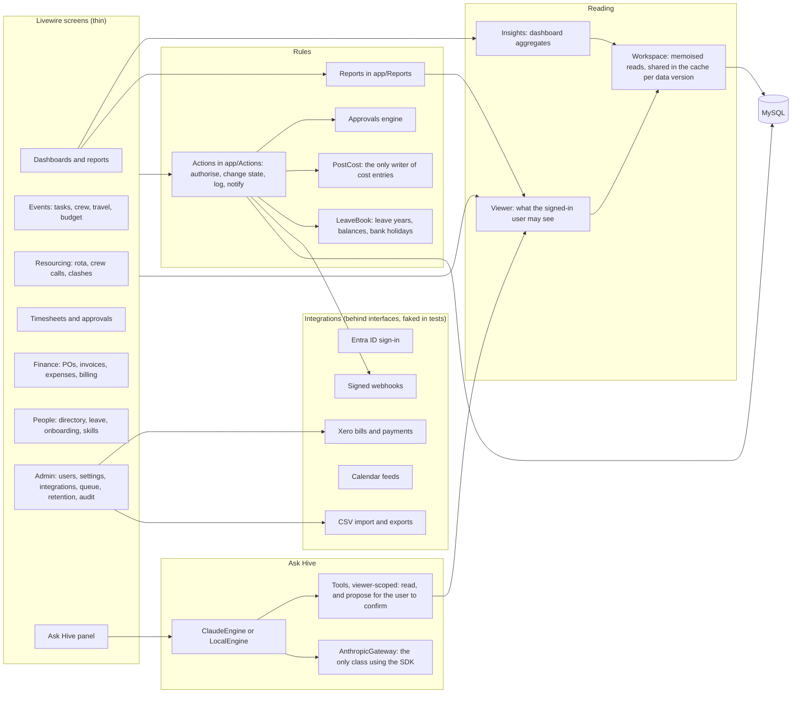

# Hive architecture

Hive is one Laravel 12 application: Livewire screens on top of Actions, which hold every business rule, over Eloquent models. This page shows how the parts fit; `CLAUDE.md` says where each lives.

## Modules

## A request

1. Middleware: sign-in (Fortify, or Microsoft through `SingleSignOnController`), two-factor for the roles that need it, route permissions (`can:` and `can_any:`).
2. The Livewire component reads through `Viewer` (scoped to the user) and `Workspace` (all records as arrays, memoised; table reads are shared between requests in one cache entry until the data changes).
3. Changes go to an Action, which authorises with `Gate::forUser($user)`, writes in a transaction, logs to the activity log, notifies people (`Workspace::notify`, respecting their preferences), and calls `Workspace::forget()`, which also moves the shared cache to a new version.
4. Slow or outward work is queued: Ask Hive answers, webhook deliveries, clash notices.

## Background work

The scheduler (`routes/console.php`) runs reminders, digests, the health check of event budgets, retention flags, the leave year and the Xero sync. A queue worker runs the queued jobs. Failed jobs appear on Admin › Queue.

## Data that never leaves

Restricted person fields are encrypted at rest, never cached, never sent to Ask Hive, and only included in the travel manifest and subject access export for people with `people.view_restricted`. Rates are removed by `Viewer` for anyone without `rates.view`. Webhook payloads carry codes, names, dates and statuses only.
